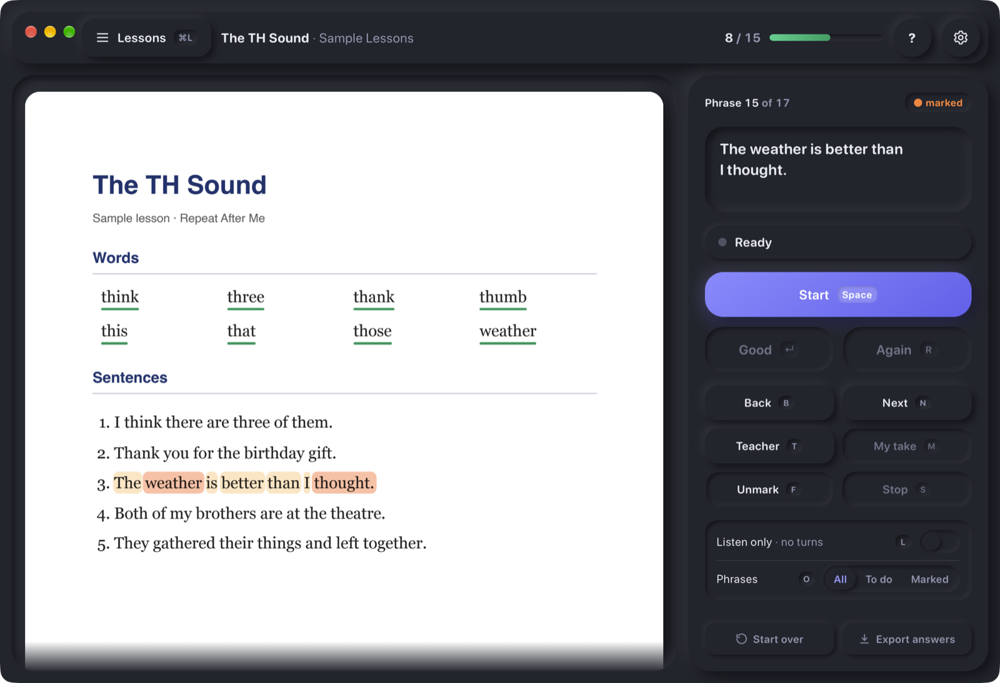

# Repeat After Me

[](LICENSE)




Practise pronunciation with your course's recordings. Add a lesson (its audio and its PDF):
the words light up in the PDF as the teacher says them. Then, phrase by phrase:

1. the teacher says it,
2. you say it (the mic stops by itself when you stop talking),
3. you hear **the teacher and then yourself**, back to back,
4. **you decide**: <kbd>Enter</kbd> good, next phrase · <kbd>R</kbd> again.

Nothing grades you. Your progress (which phrases you called good, how many tries) is saved per lesson.
Everything runs on your computer: no account, no internet, your voice is never saved to disk.

Windows, macOS and Linux. Installer ~200 MB, nothing else to download.

## Download

**[Download the latest release](https://github.com/SashaGo3/RepeatAfterMe/releases/latest)**, pick the file for your system:

| | |
|---|---|
| **macOS** (Apple Silicon and Intel, 11+) | `Repeat After Me_x.y.z_universal.dmg`, drag the app to Applications |
| **Windows** 10/11 | `Repeat After Me_x.y.z_x64-setup.exe` (or the `.msi`) |
| **Linux** | `.AppImage` (any distro), `.deb` (Ubuntu/Debian) or `.rpm` (Fedora) |

The first time it's your turn, your system asks for microphone access. Allow it.

The macOS app is signed with a Developer ID and notarized by Apple, so it opens like any other app.
If Windows shows "Windows protected your PC", the Windows build is not signed with a paid certificate: click
**More info → Run anyway**. Every installer is built from this source by
[GitHub Actions](.github/workflows/release.yml).

## Using it

To try it without your own course, add the [`samples/`](samples) folder: a short lesson on the TH sound
(a PDF and a recording made for this project).


**Add lessons:** drop a folder (or a `.zip` of one) on the window, or **File → Add a Folder of Lessons…** (<kbd>⌘/Ctrl</kbd>+<kbd>Shift</kbd>+<kbd>O</kbd>).
Each recording is paired with the PDF of the same name in its folder, else the closest name
("Light L **vs.** Dark L.m4a" ↔ "Light L **and** Dark L.pdf"), else the folder's only PDF. Wrong pair: **⋯ → Use a
different PDF…** in the lesson list. Files stay where they are (a zip is unpacked into the app's data folder). Progress follows a lesson's *content*, so moving
or renaming the files keeps it.

The first time you open a lesson, the app listens to it once to find where each word is (about 1 s per 20 s of
audio). After that it opens instantly.

### Keys

Every button shows its key. <kbd>?</kbd> lists them all.

| Key | |
|---|---|
| <kbd>Space</kbd> | Start · skip to my turn · done talking · hear both again |
| <kbd>Enter</kbd> | Good: next phrase |
| <kbd>R</kbd> | Again |
| <kbd>B</kbd> / <kbd>←</kbd> / <kbd>Esc</kbd> | Back: the previous phrase |
| <kbd>N</kbd> / <kbd>→</kbd> | Next phrase |
| <kbd>T</kbd> / <kbd>M</kbd> | Teacher only / my take only |
| <kbd>F</kbd> / right-click a word | Mark the phrase's words for attention (orange); again to unmark |
| <kbd>O</kbd> | Which phrases: all · to do (not called good yet) · marked |
| <kbd>L</kbd> | Listen only: play the lesson through with highlighting, no turns |
| <kbd>S</kbd> | Stop |
| click a word | Practise that phrase |
| <kbd>⌘/Ctrl</kbd>+<kbd>L</kbd> | Lessons |
| <kbd>⌘/Ctrl</kbd>+<kbd>+</kbd> <kbd>−</kbd> <kbd>0</kbd> | Zoom the PDF |
| <kbd>⌘/Ctrl</kbd>+<kbd>R</kbd> | Look for new lessons in your folders |

To practise a lesson from scratch: **Start over** under the practice buttons, **⋯ → Start over…** in the lesson list,
or **File → Start This Lesson Over…**. Every phrase goes back to not done; your marked words and time practised stay.

The lesson list shows how long you've practised each lesson and when you last did; search it, or sort it by folder,
recently practised, most practised or name. **⋯** on a folder renames it or takes it off the list; **⋯** on a lesson
clears its marked words, picks another PDF or removes it. Lessons you add later to a folder you added are found when the
app starts (or with **↻** / **File → Look for New Lessons**); ones you removed stay removed.

**File → Back Up Progress…** saves all your progress in one file; **Restore Progress…** adds a backup to what's there
(nothing is lost), also on another computer: lessons are known by their recording, wherever the files are.

Your data (lesson list, progress, transcripts) is in the app's data folder: **File → Show Saved Progress**.
**Settings → Progress** clears all progress (marked words stay), or resets the app to how it was the first time
(your lesson files are never touched).

## How it works

One Rust library (`core/`) does everything; the window (`app/`, Tauri) and the screen (`ui/`, Svelte) only show
its state and pass on what you press.

| | |
|---|---|
| Audio files | `symphonia` (mp3, m4a/AAC/ALAC, wav, flac, ogg) |
| Where each word is | `whisper.cpp` *small.en* (190 MB, quantized), once per lesson, with the PDF's text as a hint; word times from cross-attention (DTW), trimmed to the actual speech |
| Words ↔ PDF | in-order alignment, then the page's shape decides: grids read by column (a word goes on its column's row, even when misheard as another word in the grid), cells said together stay together ("that one", "the hour"), split words are joined ("all together" → altogether), sound-alikes, misheard words between two matches, stray matches pulled back next to their neighbours |
| Phrases | a printed sentence is one phrase even with pauses in it; grid cells and items between `·` are separate |
| PDF | `pdfium`: the words with their boxes, and the page images (one engine, so highlights sit exactly on the text) |
| Speakers / mic | `cpal` (CoreAudio, WASAPI, ALSA/PulseAudio/PipeWire). Your turn ends after 0.8 s of silence; silence around your take is cut |

## Building

Needs Rust, Node 20+, CMake (for whisper.cpp) and, on Linux, `libwebkit2gtk-4.1-dev libasound2-dev`.

```sh
scripts/fetch-vendor.sh          # speech model + pdfium for this OS → vendor/ (once)
npm --prefix ui ci
cd app && ../ui/node_modules/.bin/tauri dev      # run
cd app && ../ui/node_modules/.bin/tauri build    # installer for this OS
cargo test -p ram-core           # tests (set RAM_PDFIUM_DIR=vendor/pdfium/mac-arm64/lib or similar)
```

`scripts/build-app.sh` builds the app and installer for this computer, with no trace of who built it or where: the
source paths that compilers keep for error messages are rewritten (this folder → `.`, your home → `~`), and it checks
the result.

The installers on the releases page are built by GitHub Actions on GitHub's machines from this source
(`.github/workflows/release.yml`, on a `v*` tag). The macOS app is signed with a Developer ID and notarized there; local builds are signed ad hoc.

Try a build without touching your own progress: `RAM_DATA_DIR=/tmp/ram-test <the app's executable>`.

The UI can be worked on in a normal browser: `npm --prefix ui run dev` uses a mock backend
(`ui/src/lib/mock.ts`, dev builds only) that replays a sample lesson from `ui/dev/`.

Tools for checking the engine on real lessons (`core/examples/`):

| | |
|---|---|
| `align_report <data dir> <out dir>` | every lesson in a data folder: printed words never heard, heard words not placed, matches nothing around backs up, and each spoken word → printed word. Run before and after a change to `align.rs` and `diff -r` the two folders (`RAM_ALIGN_BASELINE=1` turns the layout passes off, to see what they do) |
| `align_check <pdf> <transcript.json>` | the phrases a transcript gives (`MAP=150-300`: what each word said between 150 s and 300 s went to) |
| `transcribe_check <audio> <pdf> [reference.json]` | transcribe, then compare word times and phrases with a reference |
| `engine_check <data dir> <course folder> <lesson>` | the whole engine on the real speakers (listen-only, no mic) |

| Folder | |
|---|---|
| `core/src/align.rs` | transcript ↔ PDF, phrases |
| `core/src/transcribe.rs` | whisper.cpp |
| `core/src/session.rs` | the practice loop (tested on a fake clock) |
| `core/src/engine.rs` | loading lessons, devices, progress, events |
| `core/src/library.rs`, `progress.rs` | lesson list and pairing, progress file |
| `core/src/pdf.rs`, `audio.rs`, `device.rs` | PDF, audio maths, speakers and mic |
| `app/` | Tauri: commands, menu, `ram://` page images, bundling |
| `ui/src/lib/keys.ts` | every shortcut (handler, labels, bar and help read it) |

## Contributing

Issues and pull requests are welcome: [CONTRIBUTING.md](CONTRIBUTING.md). Security reports:
[SECURITY.md](SECURITY.md). If it helped your pronunciation, you can
[buy me a coffee](https://buymeacoffee.com/sashago3).

## License

[MIT](LICENSE). The installers also bundle the [whisper.cpp](https://github.com/ggml-org/whisper.cpp) *small.en*
model (MIT) and [pdfium](https://pdfium.googlesource.com/pdfium/) (BSD-3-Clause / Apache-2.0).
